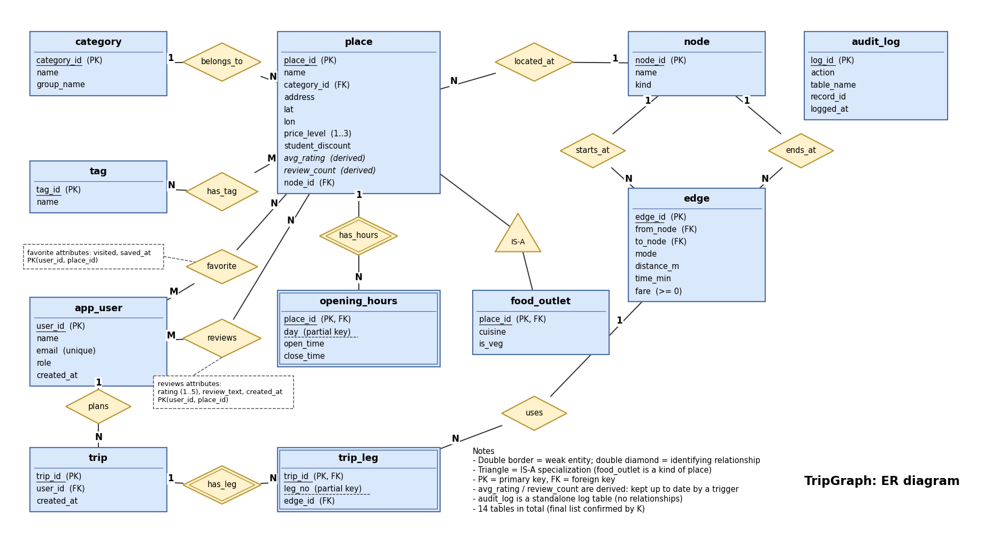

# TripGraph

### Student-Oriented Place Discovery and Route Planning System

**TripGraph** is a Database Management Systems (DBMS) project designed to organize useful places around the NSUT/Dwarka area and support route planning between them.

The project focuses on building a structured relational database that manages places, categories, student discounts, reviews, ratings, opening hours, favorites, transport routes and user trips.

PostgreSQL is used as the primary database management system, with SQL and Python used for database operations, testing and demonstrations.

> **Project Status: In Progress**
>
> The database design and a substantial part of the database implementation are available. However, the complete application is not yet finished. The frontend, backend API integration, real-world data validation and live route integration are among the remaining development areas.

---

# 1. Project Information

| Detail | Information |
|---|---|
| Project Name | TripGraph |
| Project Type | Database Management Systems Project |
| Institution | Netaji Subhas University of Technology (NSUT) |
| Subject | Database Management Systems (DBMS) |
| Faculty Guide | Mr. Anand Gupta |
| Team Members | Ayaan Chhabra, Kanishk Goswami, Anjali Kethan, Suhani Malhotra |
| Primary Database | PostgreSQL |
| Python Version Used | 3.13 |
| Current Status | In Progress |

**GitHub Repository:** [github.com/ayaanchhabra/TripGraph](https://github.com/ayaanchhabra/TripGraph)

---

# 2. Problem Statement

Students frequently need to find affordable and useful places around their college, such as food outlets, stationery shops, grocery stores, medical stores, libraries and other essential services.

However, information about these places is often scattered across different sources. Students may also find it difficult to compare prices, check student discounts, view opening hours, read reviews and determine convenient routes.

TripGraph aims to organize this information in a single database and provide a foundation for place discovery and route planning.

The system is intended to help students explore nearby places based on their requirements, compare available options and plan routes using stored transport information.

---

# 3. Proposed Solution

TripGraph uses a relational database to connect information about places, users, categories, reviews, tags, opening hours, transport locations and trips.

The database is designed around the following operations:

- Storing and organizing places based on categories.
- Maintaining ratings and reviews submitted by users.
- Identifying affordable places and available student discounts.
- Managing saved places and visited-place history.
- Checking whether a place is open at a particular time.
- Representing a transport network using nodes and edges.
- Calculating suitable routes based on fare, travel time and other constraints.
- Maintaining trip information and ordered route segments.

The current implementation focuses on the database layer and its validation through SQL and Python demonstrations.

---

# 4. Key Features

## 4.1 Place Management

Stores information about places, including:

- Place name and address.
- Geographical coordinates (latitude and longitude).
- Category and price level.
- Student discount availability.
- Associated location node.

## 4.2 Categories and Tags

Places are organized into categories such as food and drink, study and work, essentials, technology and repair, shopping and lifestyle, and hangouts.

Tags provide an additional way to classify places. A place can have multiple tags, and the same tag can be associated with multiple places.

## 4.3 Reviews and Ratings

Users can submit ratings and reviews for places.

Database triggers automatically maintain the average rating and total review count whenever a review is inserted, updated or deleted.

## 4.4 Favorites and Visited History

Users can save places as favorites and mark them as visited. The database also supports queries for listing favorites and identifying frequently saved places.

## 4.5 Opening Hours

The database stores day-wise opening and closing times. It also supports checking whether a place is currently open or will be open at a specified arrival time.

## 4.6 Route Planning

The transport network is represented through:

- **Nodes:** Locations such as college gates, metro stops, bus stops and place clusters.
- **Edges:** Directed connections between nodes containing transport mode, distance, estimated travel time and fare.

A recursive SQL query calculates routes based on fare or travel time, subject to constraints such as maximum fare, maximum number of legs and arrival deadline.

## 4.7 Similar Place Suggestions

The database includes a function that suggests places belonging to the same category and having a similar price level. Results are ranked using price difference, ratings and review counts.

## 4.8 Database Security and Audit Logging

Separate PostgreSQL roles are defined for student and administrator operations.

An audit trigger records important insert, update and delete operations on places and transport edges.

---

# 5. Database Design

The main TripGraph database contains **14 relational tables**.

| Table | Purpose |
|---|---|
| `app_user` | Stores user information and roles. |
| `category` | Stores categories of places. |
| `place` | Stores information about different places. |
| `food_outlet` | Stores additional information about food outlets. |
| `tag` | Stores available tags. |
| `place_tag` | Connects places with tags. |
| `opening_hours` | Stores opening and closing times for each day. |
| `review` | Stores ratings and reviews submitted by users. |
| `favorite` | Stores saved and visited places. |
| `node` | Represents locations in the transport network. |
| `edge` | Represents connections between transport nodes. |
| `trip` | Stores trips created by users. |
| `trip_leg` | Stores the ordered route segments of a trip. |
| `audit_log` | Records important database operations. |

## 5.1 Database Integrity

The database uses:

- Primary keys and composite primary keys.
- Foreign key constraints.
- UNIQUE constraints.
- CHECK constraints.
- Referential integrity.
- Database triggers for automatic updates and validation.

## 5.2 ER Diagram

The ER diagram represents the entities, attributes, relationships and cardinalities used in TripGraph.



---

# 6. Technology Stack

| Technology | Purpose |
|---|---|
| PostgreSQL | Primary relational database |
| SQL | Database schema, queries and operations |
| PL/pgSQL | Database functions and triggers |
| Python 3.13 | Database testing and concurrency demonstration |
| psycopg2-binary | Python-to-PostgreSQL connectivity |
| XAMPP / phpMyAdmin | Viewing the MySQL-compatible schema and Designer diagram |
| PyCharm | Python development and execution |
| Git and GitHub | Version control and project collaboration |

**Database implementation note:** PostgreSQL is the actual database engine used for the main implementation. The file `docs/er_diagram/xampp_er_diagram.sql` is a MySQL/MariaDB-compatible schema copy prepared for viewing the table structure and relationships through phpMyAdmin Designer. It is not the main executable PostgreSQL database.

---

# 7. Project Architecture

The current implementation follows a database-first structure.

```text
             Project Data
                  |
                  v
        CSV Files and Sample Data
                  |
                  v
            PostgreSQL
                  |
          +-------+-------+
          |       |       |
          v       v       v
        Tables  Triggers  Constraints
          |       |       |
          +-------+-------+
                  |
                  v
       SQL Queries and Functions
                  |
          +-------+-------+
          |       |       |
          v       v       v
        Views   Routes  Recommendations
                  |
                  v
         Python Database Testing
                  |
                  v
        Validation and Test Results
```

The planned application layer will connect the database to a user-facing frontend and backend. This integration is not yet complete.

---

# 8. Repository Structure

```text
TripGraph/
│
├── README.md
│
├── app/
│   ├── backend/
│   └── frontend/
│
├── data/
│   ├── csv/
│   ├── csv_examples/
│   ├── map/
│   ├── sample_data/
│   ├── load_all.sql
│   ├── load_places.sql
│   └── CSV_CONTRACT.md
│
├── docs/
│   ├── er_diagram/
│   │   ├── tripgraph_er.png
│   │   ├── tripgraph_er.drawio
│   │   ├── tripgraph_schema.png
│   │   ├── tripgraph_schema.dbml
│   │   ├── xampp_designer_diagram.png
│   │   └── xampp_er_diagram.sql
│   ├── presentation/
│   ├── report/
│   ├── viva_demo.md
│   └── nosql_vs_sql.md
│
├── indexing/
│   ├── benchmarks/
│   ├── fulltext_search.sql
│   ├── public_indexes.sql
│   └── viva_demo.sql
│
├── normalization/
│   ├── README.md
│   ├── functional_dependencies.md
│   ├── decomposition_steps.md
│   ├── messy_table.sql
│   └── normalized_tables.sql
│
├── queries/
│   ├── procedures/
│   ├── relational_algebra/
│   ├── trips/
│   └── views/
│
├── recovery/
│   ├── README.md
│   ├── 01_setup.sql
│   ├── 02_uncommitted_then_wait.sql
│   └── 03_verify.sql
│
├── schema/
│   ├── 01_tables.sql
│   ├── 02_constraints.sql
│   ├── 03_seed_reference.sql
│   └── 04_favorites.sql
│
├── scripts/
│   └── setup_db.sh
│
├── security/
│   ├── 01_roles.sql
│   ├── 02_grants.sql
│   └── 03_test_roles.sql
│
├── tests/
│   ├── run_tests.sh
│   ├── test_constraints.sql
│   ├── test_triggers.sql
│   ├── test_queries.sql
│   ├── test_trending.sql
│   ├── test_audit.sql
│   ├── test_similar_places.sql
│   ├── test_cheapest_edges.sql
│   └── test_freshers_guide.sql
│
├── transactions/
│   ├── README.md
│   ├── concurrent_reviews.py
│   ├── lost_update_demo.sql
│   ├── lost_update_fix.sql
│   ├── deadlock_demo.sql
│   └── deadlock_demo.sh
│
├── triggers/
│   ├── 01_review_rating.sql
│   ├── 02_trip_leg_continuity.sql
│   └── 03_audit_log.sql
│
└── user_features/
    └── favorites.sql
```

### Important Directories

| Directory | Description |
|---|---|
| `schema/` | Main relational database tables, constraints and reference data. |
| `data/` | CSV files, sample data and database loading scripts. |
| `queries/` | SQL views, route calculations and stored functions. |
| `triggers/` | Automatic database updates, validation and audit logging. |
| `security/` | PostgreSQL roles, permissions and role testing. |
| `tests/` | SQL test suite. |
| `transactions/` | Lost-update, deadlock and concurrent transaction demonstrations. |
| `normalization/` | Functional dependencies, candidate keys and BCNF decomposition. |
| `indexing/` | Indexing, full-text search and query performance benchmarks. |
| `recovery/` | Transaction recovery demonstrations. |

---

# 9. Installation and Setup

## 9.1 Prerequisites

Install the following:

1. PostgreSQL 15 or later (the project has been tested with PostgreSQL 16).
2. Git.
3. Git Bash on Windows, or Bash on Linux/macOS.
4. Python 3.13 (required for the Python concurrency demonstration).

Python is not required to create the database or run the SQL test suite.

## 9.2 Clone the Repository

```bash
git clone https://github.com/ayaanchhabra/TripGraph.git

cd TripGraph
```

## 9.3 Configure PostgreSQL

Make sure the PostgreSQL service is running.

The setup script requires a PostgreSQL user with permission to create databases and roles. A local PostgreSQL superuser such as `postgres` can be used for the classroom setup.

### Windows PowerShell

The following example assumes PostgreSQL 16 and the default Git installation directory.

```powershell
$env:Path = "C:\Program Files\PostgreSQL\16\bin;$env:Path"

$env:PGHOST = "localhost"
$env:PGPORT = "5432"
$env:PGUSER = "postgres"
```

For password authentication, use PostgreSQL's password prompt or configure a local password file using `PGPASSFILE`.

Example:

```powershell
$env:PGPASSFILE = "$env:APPDATA\postgresql\pgpass.conf"
```

The password file must contain the appropriate connection entry and should remain outside the repository. Never commit database passwords.

### Linux / macOS

```bash
export PGHOST=localhost
export PGPORT=5432
export PGUSER=postgres
```

Configure PostgreSQL authentication using your local PostgreSQL installation.

## 9.4 Create the Python Environment

This step is required only for the Python concurrency demonstration.

### Windows

```powershell
py -3.13 -m venv .venv

.\.venv\Scripts\Activate.ps1

python -m pip install --upgrade pip

python -m pip install psycopg2-binary
```

### Linux / macOS

```bash
python3 -m venv .venv

source .venv/bin/activate

python -m pip install --upgrade pip

python -m pip install psycopg2-binary
```

## 9.5 Create and Initialize the Database

Run the setup script from the repository root.

### Windows PowerShell with Git Bash

```powershell
& "C:\Program Files\Git\bin\bash.exe" scripts/setup_db.sh tripgraph postgres
```

### Linux / macOS

```bash
bash scripts/setup_db.sh tripgraph postgres
```

The setup script automatically:

1. Creates the PostgreSQL database.
2. Creates the required database roles.
3. Creates all relational tables.
4. Applies primary key, foreign key, UNIQUE and CHECK constraints.
5. Loads reference and sample data.
6. Installs database triggers.
7. Creates the configured views and functions.
8. Loads indexing and security scripts included in the setup sequence.
9. Runs the SQL test suite.

A successful setup displays:

```text
Database tripgraph is ready. Running all tests ...

==============================
ALL TESTS PASSED (failed = 0)
```

**Important:** The setup script refuses to overwrite an existing database.

The `--reset` option drops and rebuilds the specified database. Use it only when you intentionally want to delete and recreate a disposable database.

Example:

```bash
bash scripts/setup_db.sh tripgraph postgres --reset
```

Do not use this option on a database containing data you want to preserve.

---

# 10. Running Database Tests

After the database has been created, the test suite can be executed separately.

### Windows

```powershell
& "C:\Program Files\Git\bin\bash.exe" tests/run_tests.sh tripgraph postgres
```

### Linux / macOS

```bash
bash tests/run_tests.sh tripgraph postgres
```

The test suite checks:

- Database constraints and relational integrity.
- Review rating triggers.
- Trip and route queries.
- Trending-place calculations.
- Audit logging.
- Similar-place suggestions.
- Cheapest-edge queries.
- Freshers' guide queries.

Test outputs are stored in:

```text
tests/results/
```

A successful execution displays:

```text
ALL TESTS PASSED (failed = 0)
```

---

# 11. Important SQL Operations

The project contains several SQL queries and functions for demonstrating database operations.

| Operation | File |
|---|---|
| Top-rated places | `queries/views/01_top_rated_places.sql` |
| Currently open places | `queries/views/02_open_now.sql` |
| Trending places | `queries/views/03_trending_this_month.sql` |
| Cheapest route | `queries/trips/01_cheapest_route.sql` |
| Similar-place suggestions | `queries/procedures/01_similar_places.sql` |
| Favorite and visited-place operations | `user_features/favorites.sql` |
| Full-text search | `indexing/fulltext_search.sql` |

### Example Queries

```sql
-- View top-rated places
SELECT * FROM top_rated_places;

-- View places currently open
SELECT * FROM open_now;

-- Find similar places
SELECT * FROM similar_places(1);

-- Calculate a route to a place
SELECT * FROM cheapest_route(1);

-- View trending places
SELECT * FROM trending_this_month;
```

### Optional Full-Text Search Setup

The full-text search module is available separately and is not included in the default database setup sequence.

To install it:

```bash
psql -U postgres -d tripgraph -v ON_ERROR_STOP=1 -f indexing/fulltext_search.sql
```

Then refresh the database grants:

```bash
psql -U postgres -d tripgraph -v ON_ERROR_STOP=1 -f security/02_grants.sql
```

Example:

```sql
SELECT * FROM search_places('veg cafe wifi');

SELECT * FROM places_with_tags(ARRAY['veg', 'wifi']);
```

---

# 12. Python Concurrent Review Demonstration

The project includes a Python script that tests how the database handles multiple users submitting reviews for the same place simultaneously.

**Script:** `transactions/concurrent_reviews.py`

The script uses Python threads and PostgreSQL connections through `psycopg2`.

### Run the Demonstration

```bash
python transactions/concurrent_reviews.py \
  --dsn "host=localhost port=5432 dbname=tripgraph user=postgres" \
  --place-id 1 \
  --reviews 20 \
  --isolation "read committed"
```

The script performs the following operations:

1. Creates temporary reviewer accounts.
2. Starts multiple reviewers using a thread barrier.
3. Inserts reviews for the same place concurrently.
4. Calculates the actual review count and average rating.
5. Compares them with the values stored in the `place` table by the trigger.
6. Displays whether the stored values match.
7. Deletes the temporary reviewer accounts and their associated reviews.

### Example Successful Output

```text
Starting 20 reviewers at the same moment ...

Real reviews in the review table:
count=26, avg=3.12

Stored on the place row (trigger):
count=26, avg=3.12

RESULT: CORRECT.
The stored numbers match the real reviews.
```

The exact values depend on the current database records.

**Safety note:** The script clears its reserved temporary user ID range before creating test users. Run it only against a local demonstration database, not a production database.

---

# 13. Normalization and Database Design

The project also includes a separate normalization demonstration.

The `normalization/` directory contains:

- A deliberately denormalized table.
- Examples of insertion, update and deletion anomalies.
- Functional dependencies and attribute closures.
- Candidate keys and minimal cover.
- Decomposition from 1NF to BCNF.
- Lossless-join proof using the chase method.
- Dependency-preservation analysis.
- Final normalized demonstration tables.

### Run the Normalization Demonstration

```bash
psql -U postgres -d tripgraph -v ON_ERROR_STOP=1 -f normalization/messy_table.sql

psql -U postgres -d tripgraph -v ON_ERROR_STOP=1 -f normalization/normalized_tables.sql
```

The normalized demonstration uses a separate `norm_demo` schema and does not replace the main TripGraph database tables.

For detailed instructions, see:

`normalization/README.md`

---

# 14. Indexing and Query Optimization

The project includes indexing demonstrations to study how indexes influence query execution.

The repository covers:

- B-tree indexes.
- Hash indexes.
- GIN indexes.
- Composite indexes.
- Partial indexes.
- Full-text search.
- Query-plan analysis using `EXPLAIN ANALYZE`.

The `indexing/benchmarks/` directory contains benchmark queries, scripts and recorded execution plans.

A separate `bench` schema is used for large generated datasets so that benchmark data does not interfere with the main demonstration data.

The query plans and execution times depend on the database size, PostgreSQL configuration and system hardware.

---

# 15. Transactions, Concurrency and Recovery

The repository contains demonstrations of important transaction-management concepts.

### Lost Update

Files:

- `transactions/lost_update_demo.sql`
- `transactions/lost_update_fix.sql`

These scripts demonstrate the lost-update problem and its correction using row-level locking.

The actual review-rating trigger uses `FOR NO KEY UPDATE` to serialize rating recalculations for the same place.

### Deadlock Demonstration

Files:

- `transactions/deadlock_demo.sql`
- `transactions/deadlock_demo.sh`

These demonstrate how transactions can enter a circular wait and how consistent row-locking order helps prevent deadlocks.

### Recovery Demonstration

The `recovery/` directory contains SQL scripts for demonstrating transaction commit, uncommitted work and rollback after backend termination.

These exercises are intended for a local demonstration environment.

---

# 16. Current Project Status and Incomplete Areas

TripGraph is an ongoing project. The database layer has been developed substantially, but the complete application is still under development.

The following table describes the current implementation status.

| Component | Status | Details |
|---|---|---|
| ER Model and Relational Schema | Implemented | ER diagram and 14 relational tables are present. |
| Database Constraints | Implemented | Primary keys, foreign keys, UNIQUE and CHECK constraints. |
| Database Triggers | Implemented | Review rating updates, trip-leg continuity and audit logging. |
| SQL Queries and Views | Implemented | Route calculation, open places, top-rated places and similar-place suggestions. |
| Database Security | Partially Implemented | PostgreSQL roles and grants exist; application-level user authentication and ownership enforcement are pending. |
| Normalization | Implemented | Functional dependencies, candidate keys and BCNF demonstration are available. |
| Indexing | Implemented | Index definitions, full-text search and benchmark scripts are available. |
| Transaction Testing | Implemented | Lost-update, concurrency and deadlock demonstrations are available. |
| Frontend | Not Yet Implemented | The `app/frontend/` directory currently contains only a placeholder. |
| Backend API | Not Yet Implemented | The `app/backend/` directory currently contains only a placeholder. |
| Live Map Integration | Not Yet Implemented | No external mapping or real-time navigation service is connected. |
| Production Data Integration | In Progress | Current map data is a small demonstration dataset and requires real-world verification and expansion. |
| Complete Application Deployment | Pending | The database has been tested locally, but a complete user-facing application has not been deployed. |

## 16.1 Main Areas That Still Need Development

### 1. Frontend Development

A user-facing interface is still required to allow students to search for places, view details, filter results, manage favorites, read reviews and plan trips.

### 2. Backend API Integration

A backend application layer needs to be developed to connect the frontend with PostgreSQL and expose the existing database functionality through suitable APIs.

### 3. User Authentication and Authorization

Although database roles and permissions have been created, complete application-level authentication, session handling and enforcement of user-specific data ownership are still pending.

The current database does not implement row-level security (RLS), so this ownership enforcement must be completed in the application layer before multi-user deployment.

### 4. Real-World Map Data

The current transport network contains a small hand-built map of 15 nodes and 32 directed edges. Its place names, distances and fares are estimates and need to be validated and expanded using reliable local data.

### 5. Live Navigation and External Integrations

The current route calculation works with stored node, edge, distance, time and fare information. Integration with external map providers, GPS, real-time traffic and live public transport information has not yet been implemented.

### 6. End-to-End Testing and Deployment

The database components have individual SQL and Python tests. Complete end-to-end testing of the future frontend, backend and database integration remains to be done.

**Current development focus:** Completing the application layer, connecting it to the existing database, improving the accuracy and coverage of place and route data, and validating the complete user workflow.

---

# 17. Additional Documentation

| Document | Description |
|---|---|
| `docs/er_diagram/tripgraph_er.png` | Original ER diagram. |
| `docs/er_diagram/tripgraph_schema.png` | Relational schema diagram. |
| `docs/er_diagram/xampp_designer_diagram.png` | phpMyAdmin Designer diagram. |
| `docs/viva_demo.md` | Database demonstration and viva instructions. |
| `docs/nosql_vs_sql.md` | SQL and NoSQL comparison. |
| `data/CSV_CONTRACT.md` | CSV file format and data requirements. |
| `normalization/README.md` | Normalization walkthrough. |
| `transactions/README.md` | Concurrency and lost-update demonstrations. |
| `recovery/README.md` | Transaction recovery demonstrations. |
| `indexing/benchmarks/README.md` | Indexing benchmark instructions. |

---

# 18. Team

Developed as a Database Management Systems project at **Netaji Subhas University of Technology (NSUT)**.

| Name | Roll Number |
|---|---|
| Ayaan Chhabra | 2025UCM2333 |
| Kanishk Goswami | 2025UCM2305 |
| Anjali Kethan | 2025UCM2340 |
| Suhani Malhotra | 2025UCM2359 |

**Faculty Guide:** Mr. Anand Gupta

---

### TripGraph

*Organizing places, connecting routes and making student exploration easier.*

**Repository:** [github.com/ayaanchhabra/TripGraph](https://github.com/ayaanchhabra/TripGraph)
